<picture>
  <source media="(prefers-color-scheme: dark)" srcset="assets/header-dark.svg">
  
</picture>

  
  
  
  
  
  
  
  
  

> **I ship AI into production, not demos.** Ten-plus years of high-load, data-heavy backends in fintech, crypto, retail and automotive, most of them leading engineering teams. Since 2024 I run **[katelabs](https://katelabs.io)**: every English-language crypto headline scored by a language model within minutes of publication, aggregated into an index, tested, costed and **traded live, trade by trade in public**.

## 🧭 Who I am

- 👨‍💻 Writing software for money **since I was 17**. The last decade: system design across **hundreds of services under load**, performance and infrastructure work, and lately **AI engineering**, including the unglamorous part where the system has to **detect its own failures, fail over and roll data back on its own**.
- 🎓 Mathematics and computer science, **Ural Federal University**, Faculty of Mathematics and Mechanics.
- 📍 **Belgrade, Serbia**, remote-friendly.
- 🗣️ The thing I do best is **talking to people, from engineers to the board**, and turning that into systems that hold.

## ⚡ Now

| | |
|---|---|
| 🚗 **Rivian** | Senior software engineer, **domain owner for Parts Management**: the architecture of hundreds of microservices for parts logistics and analytics, the domain's event-driven backbone on **Redpanda**, its **federated GraphQL** schemas, on-call, and mentoring senior engineers. |
| 📰 **katelabs** | Running the pipeline and the live account, writing research notes. <!-- katelabs-stats:start -->Collecting since 4 October 2024; 243,632 headlines scored as of 28 October 2026.<!-- katelabs-stats:end --> |

## 📰 katelabs, by the numbers

<table>
  <tr>
    <td align="center"><b>🗞️ 243k+</b> headlines scored, point in time, never revised</td>
    <td align="center"><b>📡 109</b> news outlets, around the clock</td>
    <td align="center"><b>🪙 37</b> coins in the cross-section</td>
    <td align="center"><b>⏱️ 11 min</b> median from publication to score</td>
    <td align="center"><b>🎯 57 / 62</b> live trades matched to the simulator one to one, eight weeks</td>
  </tr>
</table>

**The finding in one line:** a single headline *describes* the price move that already happened; the daily *flow* of headlines, measured against each coin's own norm, *predicts* the next two days, a little, and the paper prices what it costs to collect.

- 📄 **Paper:** [The flow, not the headline: point-in-time LLM sentiment and the cross-section of cryptocurrency returns](https://ssrn.com/abstract=7669918), SSRN working paper, October 2026.
- 🤗 **Data:** a public three-month sample on [Hugging Face](https://huggingface.co/datasets/katelabs/crypto-news-scored); full history, live feed and API at [katelabs.io/docs](https://katelabs.io/docs).
- 📈 **Live record:** every real trade set against the simulated deal of the same configuration, [note 3](https://katelabs.io/research/live-vs-simulator); all simulated deals per coin on [alpha evidence](https://katelabs.io/alpha-evidence).

<b>📚 Research notes, in reading order</b>

 

| # | Note | One line |
|---|---|---|
| 1 | [A single headline describes the price. The flow of headlines predicts it, a little.](https://katelabs.io/research/news-flow) | Two years, 37 coins: a coin's news tone against its own norm is followed by about ¼% a day for two days. |
| 2 | [Loud or positive?](https://katelabs.io/research/attention-vs-tone) | Coverage volume predicts how much a coin moves; tone predicts which way. Different information. |
| 3 | [Live against the simulator](https://katelabs.io/research/live-vs-simulator) | Eight weeks of real trades, 57 of 62 matched one to one; live and simulated earned the same. |
| 4 | [Anatomy of the flow](https://katelabs.io/research/anatomy-of-the-flow) | What the dataset is: who writes, when, about which coins, how fast it arrives, and what the scores look like. |
| 5 | [Two kinds of headline](https://katelabs.io/research/what-the-label-adds) | What the proactive / reactive label adds to the score, and what it does not. |
| 6 | [Who moves the crypto market?](https://katelabs.io/research/who-writes-first) | 61 outlets ranked by what price does before and after their headlines. Nobody moves it; the index comes from all of them together. |
| 8 | [What it would take to trade the flow](https://katelabs.io/research/cost-of-trading-the-flow) | Turnover, costs and holding period: the information is real, the naive strategy is small. |
| 9 | [From a measurement to a rule](https://katelabs.io/research/from-measurement-to-a-machine) | Five things a trader would do with the index, tested: what works, what breaks, and why the dip selects the losers. |

## 🛠️ Work

| | | |
|---|---|---|
| **May 2024 – now** | 🚗 **Rivian Automotive** Belgrade, remote | Senior software engineer, **domain owner for Parts Management**: the architecture of hundreds of microservices for parts logistics and spare-parts analytics, and the architectural reference for several teams. Moved the domain's event-driven architecture to **Redpanda without downtime**; own its **federated GraphQL** schemas (Cosmo Router) and the on-call rotation; led **Warranty & Returns** from first design to production and shipped the **VIN-printing** system; modernised CI/CD and cut AWS costs; mentor senior engineers, several promoted. |
| **Oct 2024 – now** | 📰 **katelabs** formerly Quant Lambda · Belgrade | Founder and engineer. A real-time **LLM pipeline** (Go, TypeScript, PostgreSQL) that scores every English-language crypto headline within minutes of publication and stores it **point-in-time**, a per-coin news index served via API, research across 37 coins on how news tone and volume lead price, and a **live trading record on Binance spot**, published trade by trade and matched to the simulator one to one. |
| **Jan 2022 – May 2024** | 🎮 **Playrix** Belgrade | Led the **Expert Team** at a top mobile games publisher: a cross-cutting group of senior engineers that set the architecture and engineering standards for all product teams, backend and frontend. • Unified the stack and architectural standards across product teams; **cut time-to-market** for new services. • Platform and backend: **authentication and authorization, CI/CD pipelines, the release system**, infrastructure and cost reduction. • Designed **two generations of the company-wide React UI library**. • Lead expert on **15+ services**; drove architecture reviews and service decomposition; mentored engineers across teams. |
| **Dec 2020 – Jan 2022** | 🛒 **Trinity** Moscow | Senior software engineer, then tech lead. **First engineer** on a React Native retail platform that merged sales, inventory and 1C accounting into one application; defined its backend architecture and system design. The product grew to commercial clients and was **acquired by a major retail chain**. |
| **Jul – Dec 2020** | 🎥 **City Entertainment Ticketing** Moscow | Senior full-stack engineer. Returned to lead the build of a **high-load live-streaming platform** during COVID-19: thousands of concurrent paying viewers and real-time interactive features. |
| **Feb 2019 – Jul 2020** | 👟 **kari** Yekaterinburg | Tech lead at a retail chain. A **workforce forecasting model** and a real-time shift management system that cut labour costs; a **B2B partner marketplace** centralising inventory analytics and procurement. |
| **May 2018 – Feb 2019** | 💸 **Hiero Technologies** Moscow | Senior software engineer, tech lead of four. Investment platform MVP with a **proprietary Bitcoin and Ethereum payment gateway**. |
| **Aug 2017 – May 2018** | 🎟️ **City Entertainment Ticketing** Moscow | Full-stack engineer. A distributed **master–replica server architecture** and a custom **2D seat-selection widget** (Canvas, PixiJS) for concert halls, cutting latency and improving conversion. |
| **May 2015 – Feb 2017** | 🔋 **Smirnov Batteries** Yekaterinburg | Full-stack engineer. Internal logistics and inventory software that streamlined warehouse operations. |

🎓 **Ural Federal University**, Yekaterinburg, 2013 – 2017. Faculty of Mathematics and Mechanics, mathematics and computer science.

## 🧰 Stack

  
  
  
  
  
  
  
  
  
  
  
  
  
  
  
  
  
  
  
  

## 🤝 Open to

**Consulting, mentorship and joint ventures.** I can take an entire department from where it is to where it needs to be: I am driven by results, and the thing I do best is talking to people, from engineers to the board. I am building **katelabs full-time with the right partner**. If that is you, [write](mailto:aler.senkevich3301@gmail.com).

  <picture>
    <source media="(prefers-color-scheme: dark)" srcset="https://raw.githubusercontent.com/l3xxxy/l3xxxy/output/github-snake-dark.svg">
    
  </picture>

